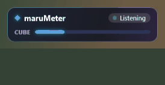
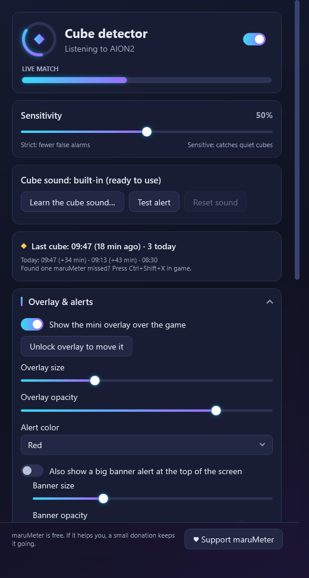

# maruMeter

A free Windows companion app for **Aion 2**:

- **Hidden Cube detector:** listens to the game's audio for the Hidden Cube's hum and shows a big on-screen alert
  with which side it's on and how close. Made for players who can't easily hear it.
- **DPS meter:** a live overlay with your party's damage, DPS and share in the current fight, plus your own skills.
- **Fight history:** every fight is saved, so you can follow your DPS, share and rank in big fights over the days.

## Download

**[Download the latest version](../../releases/latest)**, then open `maruMeter-Setup-<version>.exe` under *Assets*.

## Install

1. Run `maruMeter-Setup-<version>.exe`. It installs for your Windows user only (no admin prompt).
   - Windows may show **"Windows protected your PC"** because the app isn't code-signed.
     Click **More info → Run anyway**. Your browser may also ask whether to keep the file: choose **Keep**.
2. **For the DPS meter**, install [Npcap](https://npcap.com/#download) with its default options, then restart maruMeter.
   Setup tells you if it's missing. The cube detector works without it.
3. Start maruMeter from the Start menu.

**Update:** run the newer setup over the old one. Your settings and history are kept.
**Uninstall:** Settings → Apps → maruMeter → Uninstall. It asks whether to also delete your data.

## Requirements

- Windows 10 (2004 or later) or Windows 11, 64-bit
- Aion 2 in **borderless windowed** mode (the overlay can't draw over exclusive fullscreen)
- For reliable left/right cube direction: game audio set to stereo / headphones

## Getting started with the cube detector

maruMeter comes with a **built-in cube sound**, so there's nothing to set up: start it, play Aion 2, and when a cube's
hum is detected the overlay shows **CUBE NEARBY ◄ LEFT · CLOSE**.

**Optional:** you can teach it your own recordings with **Learn the cube sound…** (or press **Ctrl+Shift+C** in game
when you hear a cube, and it learns from the last 30 seconds). If anything goes wrong, **Reset sound** brings back the
built-in sound.

## Privacy and safety

- The cube detector only listens to audio Windows is already playing.
- The DPS meter only reads copies of the game's network packets (through Npcap). It never changes, blocks or sends anything,
  and never touches game memory or files.
- Everything stays on your PC, in `%LOCALAPPDATA%\maruMeter`. maruMeter sends no data anywhere.

maruMeter is an unofficial fan project, not affiliated with or endorsed by NCSOFT. Use it at your own risk.

## Support

maruMeter is free. If it helps you, you can support it on **[Ko-fi](https://ko-fi.com/lulmaru)** ♥
(there's also a **Support maruMeter** button at the bottom of the app's main window).
